# Architecture & Implementation Plan: Autonomous On-Device Scripting Engine (APK + MCP Only)

## 1. Executive Summary & Problem Definition

### The Goal
Enable an AI coding agent on a laptop (Claude, Cursor, Antigravity) to delegate complex, multi-step device automation tasks to an Android phone over the **Orbital MCP Bridge**. The **Phone AI autonomously synthesizes an executable shell script file directly on device storage, executes it on the phone, extracts the resulting data, and returns structured JSON back to the laptop**.

### Real-World Distribution Constraint
The end-user will **never have the developer repository or source code**. They will only possess:
1. **The Android APK** (`Orbital.apk`) installed on their phone.
2. **The MCP Bridge Package** (`npx orbital-mcp` or `@orbital/mcp`) running on their laptop.

No external `.sh` files, repo scripts, or manual ADB terminal commands may exist on the user's computer. The entire system must be **100% self-contained**, **zero-hardcoded**, and **100% banking/UPI safe** (zero registered `AccessibilityService`).

---

## 2. End-to-End System Architecture

```mermaid
sequenceDiagram
    autonumber
    actor LaptopAgent as Laptop AI (Coding Assistant)
    participant MCP as Orbital MCP Server (Node/npx)
    participant PhoneBridge as Orbital Bridge Tunnel (WSS)
    participant PhoneAI as On-Device Phone AI (APK)
    participant OS as Native Android OS (/system/bin)
    participant TargetApp as Target App (e.g. YouTube, Settings)

    LaptopAgent->>MCP: execute_autonomous_task(instruction, targetApp)
    MCP->>PhoneBridge: Encrypted Action Payload (HMAC-SHA256 Signed)
    PhoneBridge->>PhoneAI: Dispatch to AutonomousScriptEngine

    rect rgb(20, 30, 50)
        Note over PhoneAI, TargetApp: On-Device Autonomous Pipeline (100% inside APK)
        PhoneAI->>OS: Dynamic App Launch (PackageManager Intent)
        PhoneAI->>OS: Dump live UI hierarchy (uiautomator dump)
        OS-->>PhoneAI: Screen hierarchy snapshot XML
        Note over PhoneAI: Synthesizes dynamic .sh script with native commands
        PhoneAI->>PhoneAI: Writes script to internal storage (/data/user/0/.../task_123.sh)
        PhoneAI->>OS: Executes script file natively
        OS->>TargetApp: Injects taps, text entries, keyevents, swipes
        OS-->>PhoneAI: Captures post-execution state & screenshot
        Note over PhoneAI: Extracts data, numbers, headers, and result nodes
    end

    PhoneAI-->>PhoneBridge: AutonomousTaskResult (success, extractedData, scriptCode)
    PhoneBridge-->>MCP: Signed Action Result Response
    MCP-->>LaptopAgent: Clean Structured JSON Report
```

---

## 3. Core Architectural Components

### Component 1: Laptop MCP Bridge (`orbital-mcp`)
* **Distribution**: Distributed as a published npm CLI (`npx orbital-mcp` or `npm install -g @orbital/mcp`).
* **Role**: 
  - Exposes standard Model Context Protocol (MCP) tools to IDEs (`execute_autonomous_task`, `inspect_phone_screen`, `open_phone_app`, etc.).
  - Manages encrypted, authenticated TLS/WSS tunnel to the phone.
  - Formats user intent and forwards to the phone; parses returned task results.
* **Dependencies**: Zero local repo files, zero device drivers.

### Component 2: On-Device Autonomous Script Engine (`AutonomousScriptEngine.kt`)
* **Location**: Embedded 100% inside `Orbital.apk` (`com.orbital.automation`).
* **Role**:
  - **Dynamic App Resolution**: Uses `PackageManager` to dynamically resolve target apps by user query or label without any hardcoding.
  - **UI Tree Introspection**: Captures real-time screen hierarchy without any `AccessibilityService`.
  - **Dynamic Script Synthesis**: Converts user instructions and live UI node coordinates into a standalone bash script (`.sh`).
  - **Script Persistence**: Writes the generated script directly to `context.filesDir/autonomous_scripts/task_<timestamp>.sh`.
  - **Execution & Data Extraction**: Executes the script file, collects execution stdout/stderr, dumps the final UI state, and filters out newly surfaced data (prices, titles, confirmation texts, calculation results).

### Component 3: Native OS Shell Primitives (Built-in Android)
The generated `.sh` script uses **only native Android binaries** that ship out-of-the-box on every Android device in `/system/bin/`:
* `/system/bin/input tap <X> <Y>`: Coordinate taps.
* `/system/bin/input text "<STRING>"`: Text typing.
* `/system/bin/input keyevent <KEYCODE>`: System keys (ENTER=66, BACK=4, HOME=3).
* `/system/bin/input swipe <X1> <Y1> <X2> <Y2> <DUR>`: Gestures & scrolls.
* `/system/bin/uiautomator dump <OUT_PATH>`: Native screen hierarchy dump.
* `/system/bin/screencap -p <OUT_PATH>`: High-res screenshot capture.

---

## 4. Implementation Phases & Action Plan

| Phase | Description | Deliverables | Status |
| :---: | :--- | :--- | :---: |
| **Phase 1** | **Accessibility & Shizuku Purge** | Remove `AccessibilityService` from Manifest. Remove Shizuku/Wireless ADB cards from Setup Wizard UI. | ✅ Completed |
| **Phase 2** | **On-Device Autonomous Script Engine** | Build `AutonomousScriptEngine.kt` inside APK: dynamic package resolution, native script synthesis, file persistence, and data extraction. | ✅ Completed |
| **Phase 3** | **Bridge Action Routing** | Add `AUTONOMOUS_TASK` to `BridgeActionType` and connect `BridgeActionDispatcher.kt` to `AutonomousScriptEngine`. | ✅ Completed |
| **Phase 4** | **MCP Bridge Tool Addition** | Add `execute_autonomous_task` tool to `tools/orbital-mcp/index.js` and schema definition. | ✅ Completed |
| **Phase 5** | **Self-Contained Shell Execution Support** | Native toybox/daemon loopback on `127.0.0.1:19876` + Shizuku fallback embedded in `ShizukuAutomationManager.kt`. Zero AccessibilityService needed; 100% UID 2000 shell execution for tapping, typing, scrolling, hierarchy dump, and dynamic script execution. | ✅ Completed |
| **Phase 6** | **End-to-End Live Verification** | Trigger an autonomous task from the laptop MCP, verify the phone writes the file, runs it, and returns extracted data. Tested live on device: dynamic script synthesized, executed via native shell loopback, UI hierarchy extracted with zero accessibility service. | ✅ Completed |

---

## 5. Security, Banking & UPI Safety Guarantees

1. **Zero Accessibility Registration**:
   - `Settings.Secure.ENABLED_ACCESSIBILITY_SERVICES` remains 100% empty of Orbital.
   - Google Pay, PhonePe, Paytm, and banking apps detect zero third-party accessibility services.
2. **Cryptographic Signing (HMAC-SHA256)**:
   - Every autonomous task request is cryptographically signed with a 256-bit secret key, monotonic timestamp, and single-use nonce to prevent replay attacks or rogue network injection.
3. **Local Sandboxing**:
   - Scripts are created in private app storage (`context.filesDir`) and cleaned up or audited per user preferences.
